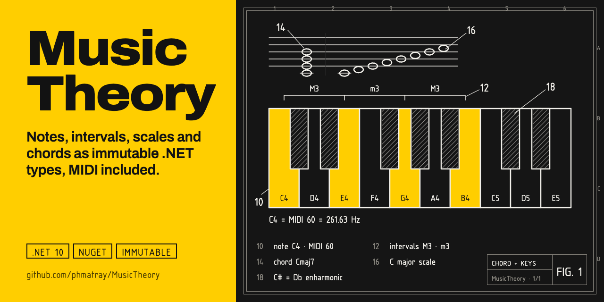

# MusicTheory

<!-- portfolio-toc:start -->

## Table of Contents

- [✨ Features](#-features)
- [📦 Installation](#-installation)
- [🚀 Quick Start](#-quick-start)
- [🎯 How it is checked](#-how-it-is-checked)
- [🧪 Testing](#-testing)
- [Tech Stack](#tech-stack)
- [🗺️ Roadmap](#️-roadmap)
- [📖 Documentation](#-documentation)
- [📄 License](#-license)

<!-- portfolio-toc:end -->

[](https://www.nuget.org/packages/MusicTheory/)
[](https://www.nuget.org/packages/MusicTheory/)
[](https://dotnet.microsoft.com/)
[](https://github.com/phmatray/MusicTheory/actions/workflows/dotnet.yml)
[](https://github.com/phmatray/MusicTheory/actions/workflows/mutation.yml)
[](LICENSE)

Music theory for .NET that spells every note correctly. Notes, intervals, scales, chords, keys and harmony
are immutable values built the way they are written on the staff, so F♯ major has an E♯ and C up to F𝄪 is a
doubly augmented fourth.

> 📦 **Install:** `dotnet add package MusicTheory` · **Docs:** <https://phmatray.github.io/MusicTheory/>

## ✨ Features

- **Notes**: letter, accidental and octave; English and German names; MIDI numbers; frequencies at any
  concert pitch (`GetFrequency(415)`); enharmonic respelling.
- **Intervals**: every quality from quintuply diminished to quintuply augmented, direction, compound
  intervals, inversion, music21 names (`M3`, `M-3`, `dd2`) with `Parse`.
- **Chords**: 44 chord types, extensions, inversions, and lead-sheet symbols with tensions (`C7b9#11`).
- **Scales**: major, three minors, seven modes, pentatonics, blues, whole tone and chromatic, spelled by interval.
  Also the melodic-minor and harmonic-minor modes (`ScaleType.Altered`, `LydianDominant`, `PhrygianDominant`),
  bebop scales (`BebopDominant`) and world scales (`HungarianMinor`, `Hirajoshi`), 22 in all.
- **Keys**: signatures including theoretical keys, the circle of fifths, relative and parallel keys.
- **Harmony**: diatonic triads and sevenths, Roman-numeral analysis, key detection, voice-leading checks.
- **Tuning and temperaments**: equal, Pythagorean, just and quarter-comma meantone temperaments, cents and frequencies.
- **Solfège**: syllables in words or ASCII, with la-based minor.
- **Modes and chord-scales**: the mode catalogue, and which scales fit a chord (`ChordScale`).
- **Piano voicings**: close, drop-2, drop-3, shell and rootless voicings, with voice leading between chords.
- **Advanced harmony**: tritone substitutions, ii-V insertion, cadence and modulation detection.
- **Rhythm**: durations with dots and tuplets, time signatures, exact measures, tempo and swing.
- **Pitch-class sets**: the Forte catalogue and neo-Riemannian transformations.
- **Instruments**: ukulele, mandolin, bass, seven-string and alternate tunings with voicings and diagrams.
- **Ear training**: seeded interval, chord, scale, progression and melody drills.
- **Import and export** (optional packages): ChordPro chord sheets, ABC tunes, Standard MIDI Files and MusicXML.
- **Guitar** (`MusicTheory.Guitar`): voicings for every chord type in any tuning, capo, chord-diagram geometry, spoken chord names and screen-reader labels in English and French.
- **Blazor** (`MusicTheory.Guitar.Blazor`): chord playback in the browser.

## 📦 Installation

```bash
dotnet add package MusicTheory
dotnet add package MusicTheory.Guitar          # optional
dotnet add package MusicTheory.Guitar.Blazor   # optional
dotnet add package MusicTheory.ChordPro        # optional
dotnet add package MusicTheory.Midi            # optional
dotnet add package MusicTheory.MusicXml        # optional
dotnet add package MusicTheory.Abc             # optional
```

Requires .NET 11.

## 🚀 Quick Start

```csharp
using MusicTheory;

Interval.Between(Note.Parse("C4"), Note.Parse("F##4"));          // AA4
Note.Parse("C4").Transpose(Interval.Parse("M-3"));                // Ab3
new Scale(Note.Parse("F#4"), ScaleType.Major).GetNotes();         // F#4 G#4 A#4 B4 C#5 D#5 E#5 F#5
ChordSymbol.Parse("C7b9#11").ToChord().GetNotes();                // C4 E4 G4 Bb4 Db5 F#5
KeySignature.Parse("Eb").AccidentalCount;                         // -3
Note.Parse("A4").GetFrequency(442);                               // 442
Note.FromFrequency(446.0);                                        // A4 +23.4¢
TunedPitch.CentsBetween(440, 880);                                // 1200
Temperament.JustIntonation.GetFrequency(Note.Parse("E4"), tonic: Note.Parse("C4"));  // 330 (pure 5/4 over a 264 C)

HarmonicAnalyzer.Analyze(
    new[] { "Dm7", "G7", "Cmaj7" }.Select(ChordSymbol.Parse),
    KeySignature.Parse("C"));                                     // ii7 V7 Imaj7

CadenceDetector.Detect(
    new[] { "C", "F", "G", "Am" }.Select(ChordSymbol.Parse).ToList(),
    KeySignature.Parse("C"));                                     // Cadence(Deceptive, 3)

// Voice leading: each voicing moves the least from the previous one.
foreach (var v in VoiceLeader.Lead(
             new[] { "Dm7", "G7", "Cmaj7" }.Select(ChordSymbol.Parse), PianoVoicingStyle.RootlessA))
    Console.WriteLine(string.Join(" ", v));
// F4 A4 C5 E5
// F4 A4 B4 D5
// E4 G4 B4 D5

// Which scales fit a chord? Fewest avoid notes first.
ChordScale.ScalesFor(ChordSymbol.Parse("G7")).Select(s => s.Type);  // LydianDominant, ..., Mixolydian, ...
ChordScale.ScalesFor(ChordSymbol.Parse("G7alt")).Any(s => s.Type == ScaleType.Altered);  // true
```

## 🎯 How it is checked

- **Against music21.** `tools/reference/generate.py` computes 3,669 intervals, 2,240 transpositions,
  315 scales and 70 key signatures with [music21](https://web.mit.edu/music21/); the tests replay every row.
- **100% coverage.** The seven packages are covered at 100% of lines and branches; CI fails below that
  (`tools/coverage/check.py`).
- **Mutation testing.** Stryker.NET runs on demand (Actions, *Mutation testing*), with break thresholds in each test
  project's `stryker-config.json`.
- **Docs that run.** Every C# block of `docs/` is compiled, run and has its printed output compared by
  `MusicTheory.DocTests`.

## 🧪 Testing

```bash
dotnet test                                                         # all suites
dotnet test --project MusicTheory.UnitTests --coverage --coverage-output-format cobertura --coverage-output $PWD/TestResults/core.xml
dotnet tool restore && (cd MusicTheory.UnitTests && dotnet stryker)  # mutation testing
UPDATE_GOLDEN=1 dotnet test --project MusicTheory.Guitar.UnitTests   # accept an intended change to the golden files
```

<!-- portfolio-techstack:start -->
## Tech Stack

- **C#**, .NET 11
- xunit.v3 on Microsoft.Testing.Platform, Shouldly
- Microsoft.Testing.Extensions.CodeCoverage, Stryker.NET
- music21 (reference tables), Roslyn scripting (doc tests), Markdig (site)

<!-- portfolio-techstack:end -->

## 🗺️ Roadmap

Everything planned in #117 to #156 has shipped. What is next lives in the
[open issues](https://github.com/phmatray/MusicTheory/issues): Documentation 2.0 (#230) and the Toolbox, a
client-side web app for music schools (#244).

## 📖 Documentation

The site at <https://phmatray.github.io/MusicTheory/> is built from `docs/` and the XML documentation by
`tools/SiteGen`: guides, tutorials, and an API reference generated from the code. Start with
[Getting started](docs/getting-started.md), then the guides for
[tuning and temperaments](docs/tuning-and-temperaments.md), [solfège](docs/solfege.md),
[modes](docs/mode-catalogue.md), [piano voicings](docs/piano-voicings.md),
[advanced harmony](docs/advanced-harmony.md), [measures and tempo](docs/measures-and-tempo.md),
[pitch-class sets](docs/pitch-class-sets.md), [instruments](docs/instruments.md),
[chord sheets and ABC](docs/chord-sheets-and-abc.md), [MIDI and MusicXML](docs/midi-and-musicxml.md) and
[ear training](docs/ear-training.md).

## 📄 License

MIT. See [LICENSE](LICENSE).
